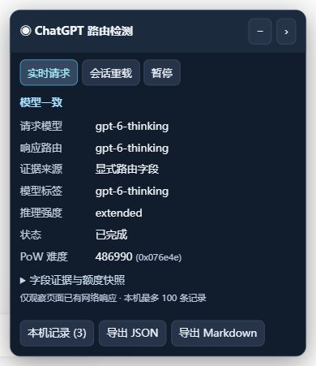

# ChatGPT 路由检测器 · 油猴版

在 ChatGPT 页面查看请求模型、响应路由、模型标签、PoW 和额度快照。无需构建，无外部依赖。

[安装 Chrome 原版 v1.0.0](https://raw.githubusercontent.com/B416-JAFLY/chatgpt-route-inspector-userscript/main/chatgpt-route-inspector.user.js) · [查看脚本源码](./chatgpt-route-inspector.user.js)

[安装 Safari 版 v1.0.2](https://raw.githubusercontent.com/B416-JAFLY/chatgpt-route-inspector-userscript/main/chatgpt-route-inspector-safari.user.js) · [查看 Safari 版源码](./chatgpt-route-inspector-safari.user.js)

## 安装

1. 在浏览器安装并启用 Tampermonkey。
2. 点击上方“直接安装”链接，在 Tampermonkey 页面确认安装。
3. 刷新已打开的 ChatGPT 页面，再发送消息或打开已有会话。右下角会出现检测面板。

如果浏览器显示脚本源码，可下载 `chatgpt-route-inspector.user.js`，复制全部内容，在 Tampermonkey → 添加新脚本中替换默认内容，按 Ctrl+S 保存。

脚本使用 `@run-at document-start`、`@grant none`、`@sandbox raw`，需要在网页主环境中观察请求。如果油猴提示脚本执行权限，请按其提示设置；参见 [Tampermonkey 官方说明](https://www.tampermonkey.net/faq.php#Q209)。

调试时注入的版本只在当前文档有效；安装后才能在刷新、重新打开页面时自动运行。

## Safari 安装与兼容处理

Safari 请安装上方的 Safari 版；在同一个浏览器里只启用一个路由检测器版本，保存后刷新 ChatGPT，再发送消息。

Safari 版将监听代码作为页面脚本显式注入，优先复用页面已有的 CSP nonce，并检查页面端启动回执；不修改页面安全策略。直接修改用户脚本环境中的 `window.fetch` 在本次 Safari 测试中没有捕获到请求，即使脚本面板能够正常显示。1.0.2 改为页面注入后，实际请求与响应已捕获成功。

如果安装链接只显示源码，在 Tampermonkey 中添加新脚本，粘贴完整代码并保存；Mac 使用 Command+S。本次测试机器在拖放文件时发生过 WebKit 崩溃，可使用编辑器粘贴方式避开拖放操作。

面板的“Safari 诊断”显示 fetch、XHR、WebSocket 监听调用数、地址匹配数及监听状态。资源匹配数来自浏览器资源时间线，不能单独证明响应正文已被捕获；以新增请求记录及模型字段为验证依据。页面端未在 10 秒内确认启动时，会显示明确提示。

## 功能

- 实时请求：显示请求模型、推理强度、响应显式路由、模型标签及采集状态。
- 会话重载：自动观察页面本身读取的会话记录，按当前分支选择回答；不主动请求历史记录。
- 支持 fetch、SSE、delta v1、XHR，以及通过主题或输入消息 ID 关联的 WebSocket 接力。
- 显示 PoW 原始十六进制值及高精度十进制换算。
- 读取响应中已有的深度研究、图片生成剩余额度与重置时间；详情中的额度带捕获时间。
- 完整面板、极简模式、右侧边缘收纳、暂停与恢复。
- 本机最多保存 100 条元数据记录，可导出 JSON 或 Markdown。

标题和字段值为近白色 `#f1f5f9`，面板背景为深蓝 `#111c2d`，正文对比度约 15.6:1。字段名对比度约 10.7:1。采用 Shadow DOM 隔离样式。

## 字段说明

“显式路由字段”来自 `resolved_model_slug` 或 `server_ste_metadata.model_slug`。“模型标签”来自回答元数据或页面 DOM。只有标签时，面板会明确标注证据来源。

出现不同字段值时，面板保留各项证据并显示差异；不会按回答质量或速度猜测模型。请求模型为 `auto` 或响应为自动推理路由时，会单独标记。没有捕获的字段显示 `—`。

PoW 为本页最近捕获值；记录中的 PoW、额度是各自捕获时的快照。重置时间按浏览器本地时区显示。

## 数据与兼容范围

脚本没有外部依赖、远程代码或额外 API 查询；不会修改请求参数和响应正文。记录存于 ChatGPT 站点的 localStorage，包含模型字段、会话/请求 ID、时间、状态、PoW 与额度，不保存提示词、回答正文、附件、Cookie 或认证令牌。清除站点数据会同时清除这些记录。

主要面向普通 ChatGPT 网页聊天。Work 模式、插件专用任务和未来协议变更尚未逐项实测。已建立的 WebSocket 无法由事后注入追溯；安装后刷新页面可尽早挂钩。原扩展的浏览器工具栏弹窗、英文界面、独立诊断页和所有专用任务关联逻辑未完整移植。

## 验证结果（2026-10-16）

- Chrome 现有标签页通过 CDP 注入，并完成两次真实临时聊天回复。
- 真实请求与响应均捕获 `gpt-6-thinking`，包含显式路由和 `extended` 推理强度。
- 修复并复测回答完成后流中止的状态：保留“已完成”。
- 从真实会话 GET 响应读取历史路由，读取真实 PoW 和额度响应。
- 实际操作确认极简、展开、边缘收纳、暂停恢复及来源切换。
- 34 项本地检查通过：SSE 分片、delta v1、WebSocket 关联、内容过滤、错误过滤、分支选择、原始 fetch Promise/响应保留、导出生成、卸载与重复注入。
- WebSocket 使用协议样例验证；本次真实回复走 SSE。
- 上述 Chrome CDP 验证未覆盖 Tampermonkey 的实际安装和 document-start 注入时机；浏览器调试接口不支持预加载注入命令。已完成的浏览器验证采用页面内 CDP 注入。

### Safari 版验证（2026-10-16）

Safari 27.0.1、Tampermonkey 5.6.6243 下实际安装 Safari 1.0.2 后，用户发送消息并取得 HTTP 200、状态“已完成”的实时记录。请求模型、`resolved_model_slug`、`server_ste_metadata.model_slug` 和模型标签均为 `gpt-6-thinking`，推理强度为 `extended`；PoW 与深度研究、图片生成额度快照也已读取。

本地自动检查使用分开的页面与扩展 JavaScript 环境，覆盖页面 nonce 注入、启动回执、注入被阻止时的提示、网络监听计数及响应字段提取。模拟测试不替代其他 Safari 版本或所有功能的实际验证。Chrome 原版文件保持不变。

## 参考

实现参考 [Liu-Bot24/chatgpt-route-inspector](https://github.com/Liu-Bot24/chatgpt-route-inspector) 的端点分类、SSE/delta 与 WebSocket 协议、路由证据区分思路。参考提交：`05d8d5ab0a263690651a5982ab6cc43aebbd2615`。本油猴版本独立编写。

界面预览见本页顶部。

